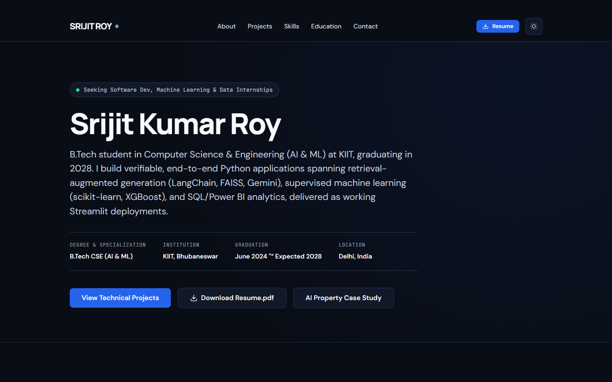

# Personal Portfolio

Source code for my personal portfolio website, where I showcase my projects in machine learning, artificial intelligence, and software development.

## Live Site

The site is hosted on GitHub Pages: **[kragenz.github.io/portfolio](https://kragenz.github.io/portfolio/)**

## Preview



## About Me

I am an undergraduate student pursuing a **B.Tech in Computer Science and Engineering (AI & ML)** at the **Kalinga Institute of Industrial Technology (KIIT)**, Bhubaneswar (graduating in 2028).

My main technical interests are:
- **Machine Learning**: Building regression and classification models with scikit-learn and XGBoost, with an emphasis on data cleaning, feature engineering, and cross-validation.
- **Natural Language Processing & RAG**: Creating semantic search and question-answering systems using embeddings, vector stores (FAISS), and LLM APIs (LangChain, Gemini).
- **Data Analytics**: Modeling relational databases in MySQL and building reporting dashboards in Power BI.

I am actively looking for internship opportunities in **Software Development**, **Machine Learning**, and **Data Analytics**.

## Projects

### 1. [AI Property Assistant — RAG Chatbot](https://github.com/KragenZ/ai-property-assistant-rag)
A conversational search tool that lets users query 500 property listings from the Ames Housing dataset in natural language.

- **Links:** [GitHub Repository](https://github.com/KragenZ/ai-property-assistant-rag) · [Live Streamlit App](https://ai-property-assistant-rag-8za8yz32sjafid8qigpxdc.streamlit.app/) · [Architecture Case Study](case_study_pa.html)
- **Tech Stack:** Python, LangChain, FAISS, HuggingFace (`all-MiniLM-L6-v2`), Google Gemini (`gemini-2.5-flash`), Streamlit
- **How it works:**
  - Converts tabular housing records into text descriptions and encodes a 500-property subset into 384-dimensional dense vectors using HuggingFace's MiniLM model.
  - Stores vectors in a local FAISS index and retrieves the top 5 nearest properties based on cosine similarity.
  - Injects retrieved listings into a LangChain prompt template for Gemini to generate an answer explaining why each listing matches the query.
  - Supports follow-up questions with conversational memory.
  - Displays retrieval time, token generation time, and an expandable context inspector in the Streamlit UI.

### 2. [House Price Predictor — Machine Learning Pipeline](https://github.com/KragenZ/house-price-predictor-ml)
An end-to-end machine learning pipeline that predicts home sale prices and explains the factors behind each prediction.

- **Links:** [GitHub Repository](https://github.com/KragenZ/house-price-predictor-ml) · [Live Streamlit App](https://house-price-predictor-ml-nh9zrtguvhpmhwsys9qexr.streamlit.app/)
- **Tech Stack:** Python, scikit-learn, XGBoost, pandas, NumPy, Streamlit
- **How it works:**
  - Trained on the Ames Housing dataset (~1,500 properties, 80 features).
  - Applied a `log1p` transformation to fix target price skewness and handled missing values across numerical and categorical columns.
  - Engineered 10 domain features (such as `TotalSF`, `HouseAge`, `TotalBath`) and encoded categorical variables.
  - Tested Ridge Regression, Random Forest, and XGBoost with 5-fold cross-validation. XGBoost performed best with **$R^2 \approx 0.91$**, **test MAE $\approx \$12,800$**, and **CV RMSE $\approx 0.12$** (log scale).
  - The Streamlit interface lets users input home details and inspect which features raised or lowered the estimated price.

### 3. FraudShield AI — Real-Time Fraud Detection *(In Progress)*
A transaction classification system currently in development to identify fraudulent mobile money transfers in highly imbalanced datasets.

- **Status:** In progress (active development)
- **Tech Stack:** Python, XGBoost, FastAPI, React, PaySim Synthetic Dataset
- **Planned Architecture & Approach:**
  - Designed around the PaySim synthetic financial dataset, where fraudulent transactions represent a very small fraction of total volume.
  - Evaluation strategy focuses strictly on **Precision, Recall, F1-Score, and PR-AUC** rather than misleading raw accuracy metrics.
  - Planned architecture: An XGBoost classifier using class weighting to handle imbalance, served via a FastAPI inference backend to an interactive React dashboard.

### 4. Target E-Commerce Analytics — SQL & Power BI
A retail business case study analyzing order transactions, freight economics, and customer spend.

- **Tech Stack:** MySQL, Power BI, SQL
- **How it works:**
  - Structured order, product, payment, and customer data into a normalized relational schema in MySQL.
  - Wrote SQL queries and aggregations to analyze order frequency, freight cost distribution, and delivery timelines.
  - Built Power BI dashboards tracking core e-commerce KPIs: Total Orders, Total Revenue, Freight Costs, and Average Order Value (AOV).

## Technologies Used

| Category | Tools & Libraries |
|---|---|
| **Languages** | Python, SQL, HTML5, CSS3, JavaScript (ES6) |
| **Machine Learning & Data** | scikit-learn, XGBoost, pandas, NumPy, matplotlib |
| **LLMs & Search** | LangChain, FAISS, HuggingFace Transformers, Google Gemini API |
| **Frameworks & BI** | Streamlit, FastAPI, MySQL, Power BI |
| **Certifications** | HackerRank Python (Basic), HackerRank SQL (Basic & Intermediate), Kudu Power BI Training |

## Implementation Details

The portfolio is built without heavy frameworks or frontend dependencies:

- **Structure**: Semantic HTML5 (`<header>`, `<main>`, `<nav>`, `<footer>`) with a skip link for keyboard users.
- **Styling**: Vanilla CSS using custom properties for design tokens. Supports both dark and light modes, reading system preferences via `prefers-color-scheme` and storing manual overrides in `localStorage`.
- **Layout**: CSS Grid and Flexbox with responsive breakpoints at 992px, 768px, and 480px. Tested to ensure no horizontal overflow on mobile screens.
- **Interactions**: Lightweight JavaScript handling the theme toggle, mobile navigation menu (with Escape-key and outside-click close handlers), scroll spy navigation highlights, and a copy-email button with a toast notification.
- **Resume View**: Includes a web-based printable resume ([`resume.html`](resume.html)) with print-specific stylesheets and a direct link to the [PDF resume](assets/Resume.pdf).

## Running Locally

No build tools or node package installations are required. Clone the repository and serve it with any local static HTTP server:

```bash
# Clone the repository
git clone https://github.com/KragenZ/portfolio.git
cd portfolio

# Option 1: Python 3
python -m http.server 8000

# Option 2: Node.js
npx serve -l 8000
```

Open `http://localhost:8000` in your web browser.

## Contact

- **Email:** [srijitroy2212@gmail.com](mailto:srijitroy2212@gmail.com)
- **GitHub:** [@KragenZ](https://github.com/KragenZ)
- **LinkedIn:** [linkedin.com/in/srijit-kumar-roy-7840043b8](https://linkedin.com/in/srijit-kumar-roy-7840043b8)
- **Location:** Delhi, India
